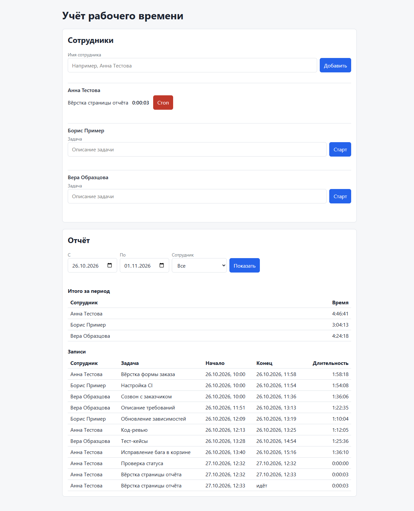

# Учёт рабочего времени

Небольшое веб-приложение для учёта рабочего времени сотрудников. Все имена и задачи в примерах вымышлены.



Что умеет приложение:

- добавляет сотрудников
- запускает и останавливает таймер с описанием задачи
- показывает записи и общее время каждого сотрудника за выбранный период
- хранит данные в файле SQLite, поэтому данные остаются после перезапуска.

## Запуск

Нужен Node.js 22.13 или новее. В этой версии модуль `node:sqlite` работает без флага.

```bash
npm ci --no-audit --no-fund
npm start          # http://localhost:3000
```

Дополнительные команды:

```bash
npm test           # тесты
npm run seed       # вымышленные сотрудники и записи (только в пустую базу)
```

Переменные окружения:

| Переменная | По умолчанию | Назначение |
| --- | --- | --- |
| `PORT` | `3000` | порт сервера |
| `DB_PATH` | `data/timetracker.db` | файл базы данных |

При запуске Node печатает предупреждение `ExperimentalWarning: SQLite is an experimental feature`. Это ожидаемо: в Node 22 модуль `node:sqlite` пока помечен как экспериментальный.

## Устройство

```
src/db.js        схема базы, открытие файла
src/repo.js      SQL-запросы: сотрудники, таймер, отчёт
src/app.js       маршруты Express и обработка ошибок
src/server.js    точка входа
public/          интерфейс на HTML, CSS и JS без сборки
scripts/seed.js  демо-данные
test/            тесты API на node:test
```

Зависимость одна — Express 5. Фронтенд не требует сборки.

### API

| Запрос | Ответ | Ошибки |
| --- | --- | --- |
| `GET /api/employees` | сотрудники и активный таймер каждого | — |
| `POST /api/employees` `{ "name": "..." }` | 201, новый сотрудник | 400 пустое имя, 409 такое имя уже есть |
| `POST /api/employees/:id/timer/start` `{ "description": "..." }` | 201, новая запись | 400 пустое описание, 404 нет сотрудника, 409 таймер уже запущен |
| `POST /api/employees/:id/timer/stop` | 200, закрытая запись | 404 нет сотрудника, 409 нет активного таймера |
| `GET /api/report?from=ISO&to=ISO&employeeId=N` | `{ entries, totals }` | 400 неверный период, 404 нет сотрудника |

### Решения

**Один активный таймер на сотрудника.** Правило держит частичный уникальный индекс в базе:

```sql
CREATE UNIQUE INDEX one_active_timer ON entries(employee_id) WHERE ended_at IS NULL;
```

Проверка «сначала SELECT, потом INSERT» в коде пропускает два почти одновременных запроса. Индекс не пропускает: второй INSERT падает, и API отвечает 409. Так работает и двойной клик, и запуск из второй вкладки.

**Период считает браузер.** Пользователь выбирает даты «с» и «по». Браузер переводит их в моменты времени по своему часовому поясу и передаёт в ISO. Сервер не знает пояс пользователя и поэтому ничего не угадывает. Дата «по» входит в период целиком: конец периода — полночь следующего дня.

**Отчёт.** В отчёт попадает запись, которая пересекает период. В итог идёт только часть записи внутри периода. Пример: работа с 22:00 до 03:00 даёт 2 часа в первый день и 3 часа во второй. У активного таймера конец равен текущему моменту. В таблице итогов есть все сотрудники. У сотрудника без записей итог 0. Пустой отчёт — это ответ 200 с пустым списком записей, а не ошибка.

**Время.** База хранит время в миллисекундах UTC. Для тестов `createApp` принимает функцию `now`, поэтому тесты управляют часами и не ждут реального времени.

## Тесты

`npm test` запускает 27 тестов в `test/api.test.js`. Тесты поднимают приложение на свободном порту с базой в памяти и проверяют сценарии через HTTP:

- создание сотрудника, пустое имя, дубль имени без учёта регистра (и для кириллицы)
- старт и стоп таймера, длительность записи
- **повторный старт таймера — 409**, в базе остаётся одна активная запись
- новый старт после остановки, независимые таймеры разных сотрудников
- стоп без активного таймера, пустое описание, несуществующий сотрудник
- **пустой отчёт**: без сотрудников и с сотрудником без записей за период
- итоги по сотрудникам, фильтр по сотруднику
- запись на границе периода, активный таймер в отчёте, будущий период
- период не в формате ISO, неверный `employeeId`
- слишком длинные имя и описание, тело запроса не JSON
- часы сервера ушли назад: длительность и итог не становятся отрицательными
- ответ API несёт время сервера в заголовке `X-Server-Time`
- **сохранение данных**: тест пишет в файл базы, закрывает её, открывает снова и находит данные.

Интерфейс я проверил в браузере через Playwright MCP. Автотестов для интерфейса нет.

## ИИ-инструменты

| Инструмент | Модель | Для чего |
| --- | --- | --- |
| Claude Code (CLI) | Claude Opus 5.5 (`claude-opus-5-5`) | план, код, тесты, README |
| Субагент Claude Code | та же модель | независимое ревью кода |
| Скилл `/code-review` в Claude Code | та же модель | второе ревью, уже по коммиту |
| Playwright MCP | — | проверка интерфейса в браузере, скриншот |
| Скилл [ui-ux-pro-max](https://github.com/nextlevelbuilder/ui-ux-pro-max-skill) | та же модель | проверка UI/UX по правилам доступности и адаптивной вёрстки |

Порядок работы:

1. Claude Code составил план и задал два вопроса: какой стек взять и что делать при повторном запуске таймера.
2. Я выбрал ответы. Claude Code написал тесты API раньше кода, потом код.
3. Claude Code проверил интерфейс в браузере через Playwright.
4. Отдельный субагент сделал ревью кода. Он не видел моих выводов, только код и требования.
5. Каждую находку ревью я проверил и закрыл тестом, где это возможно.

### Примеры запросов

Запрос 1 — постановка задачи. Это текст тестового задания целиком, без изменений.

Запрос 2 — ответы на уточняющие вопросы:

> Стек: Node + Express + SQLite. Таймер: один на сотрудника, повторный запуск возвращает ошибку 409.

Запрос 3 — ревью, которое Claude Code передал субагенту (сокращено):

> Review a small time-tracking web app for correctness bugs. Read-only: do NOT edit files. Look for: real bugs in logic, SQL, time/period math, time zones (DST), validation gaps, error handling, UI state bugs, XSS, test gaps for main scenarios. Ignore style nits. Report at most 8 findings, most severe first. For each: file:line, the concrete input/state that triggers it, the wrong result, and a suggested fix. Say plainly if a finding is uncertain.

Запрос 4 — проверка в браузере. Сценарий «таймер уже запущен в другой вкладке»: запустить таймер через API, затем нажать «Старт» на странице, где ещё видна кнопка «Старт».

## Найденные и исправленные ошибки

Все ошибки ниже — реальные. Их нашли тесты, проверка в браузере или ревью во время разработки.

### Нашли тесты

1. **Тесты не запускались.** Скрипт `node --test test/` падал с `Cannot find module '...\test'`. Node 22 не принимает папку как аргумент `--test`. Исправление: шаблон `"test/**/*.test.js"`.
2. **Дубль имени на кириллице проходил проверку.** «Борис Пример» и «борис пример» считались разными людьми. Причина: `COLLATE NOCASE` в SQLite сравнивает без учёта регистра только латиницу. Исправление: отдельная колонка `name_key` с `toLocaleLowerCase('ru')` и уникальным индексом. Сортировка списка теперь тоже идёт по `name_key`.

### Нашла проверка в браузере

3. **После старта таймера страница показывала ошибку.** Текст ошибки: `Cannot set property dataset of #<HTMLElement> which has only a getter`. Сервер таймер запустил, но на странице осталась кнопка «Старт». Причина: функция `el()` передавала `dataset` в `Object.assign`, а `dataset` можно только читать. Исправление: функция копирует значения внутрь `node.dataset`.
4. **Устаревшая страница после ответа 409.** Таймер запустили в другой вкладке. Пользователь нажал «Старт» и увидел ошибку, но кнопки «Стоп» не было. С этой страницы таймер не останавливался. Исправление: после любой ошибки таймера страница загружает актуальное состояние, а текст ошибки остаётся у сотрудника.

### Нашло ревью

5. **Сервер принимал любой текст как дату.** `Date.parse('1')` в V8 даёт дату в 2001 году, и запрос `?from=1&to=2` получал ответ 200. Время без пояса сервер читал в своём поясе. Исправление: строгая проверка ISO-формата с обязательным поясом.
6. **Длину имени и описания проверял только браузер.** Через API можно было сохранить строку до 100 КБ. Исправление: лимиты 100 и 200 символов на сервере, ответ 400.
7. **Отрицательная длительность.** Если часы сервера ушли назад между стартом и стопом, запись получала конец раньше начала и уменьшала итог. Исправление: `ended_at = MAX(now, started_at)`.
8. **Страница переставала работать после сбоя первой загрузки.** Ошибка в первом запросе останавливала весь модуль. Счётчики времени не запускались, сообщения об ошибке не было. Исправление: счётчик запускается до загрузки, ошибка выводится на страницу.
9. **Старый ответ отчёта мог заменить новый.** Пользователь быстро меняет фильтр, медленный ответ приходит последним и показывает не тот период. Исправление: страница показывает только ответ на последний запрос.
10. **Итоги отчёта не менялись, пока шёл таймер.** Счётчик в списке сотрудников шёл, а длительность в отчёте стояла. Исправление: идущая запись в отчёте получила живой счётчик, а итоги обновляются раз в минуту, пока есть активный таймер.
11. **Демо-данные сдвигались при переходе на летнее или зимнее время.** Seed отсчитывал дни шагами по 24 часа. Исправление: дата строится через `new Date(год, месяц, день, 10)`.
12. **База зависела от папки запуска.** Запуск `node src/server.js` из другой папки создавал новую пустую базу. Данные выглядели потерянными. Исправление: путь по умолчанию считается от папки проекта.

### Нашло второе ревью (`/code-review` по первому коммиту)

13. **Отрицательный итог при идущем таймере.** Часы сервера ушли назад, пока таймер шёл. SQL итога получал отрицательную долю и уменьшал итог сотрудника за другие, закрытые записи. Ошибка 7 закрыла только остановку таймера. Исправление: `MAX(0, …)` для каждой доли в сумме.
14. **Двойной Ctrl+C завершал процесс с исключением.** Второй сигнал снова закрывал уже закрытую базу. Исправление: `shutdown` срабатывает один раз.
15. **Двойная отправка формы «Добавить».** Второй запрос получал 409, и страница писала «Такой сотрудник уже есть», хотя сотрудник добавлен. Исправление: кнопка неактивна, пока идёт запрос.
16. **Старая ошибка таймера не исчезала.** Страница уже показывала верное состояние, но сообщение 409 оставалось под ним. Исправление: страница показывает ошибку один раз и убирает её через 8 секунд.
17. **Итог отставал от строки записи.** Идущая запись обновлялась каждую секунду, а итог — раз в минуту. Исправление: итог сотрудника с идущим таймером тоже получил живой счётчик. Счётчик не выходит за конец периода.
18. **Изменения из другой вкладки не появлялись.** Страница обновляла отчёт, только если сама видела идущий таймер. Исправление: страница опрашивает список и отчёт каждые 30 секунд. Список перерисовывается только при изменениях. Текст, который пользователь начал вводить в поле задачи, сохраняется.
19. **Часы браузера искажали длительность.** Счётчики считали время по часам браузера. Если они отставали от сервера, новый таймер показывал 0:00:00 несколько минут. Исправление: сервер шлёт своё время в заголовке `X-Server-Time`, страница считает по нему.
20. **Отчёт по несуществующему сотруднику отвечал 200.** Опечатка в `employeeId` выглядела как сотрудник без часов. Исправление: ответ 404, как у таймера.
21. **Запросы отчёта готовились заново на каждый вызов.** Исправление: оба запроса подготовлены один раз. Фильтр по сотруднику задан условием `:employeeId IS NULL OR …`.
22. **Итоги отчёта искали записи без подходящего индекса.** Исправление: составной индекс `(employee_id, started_at)`. `EXPLAIN QUERY PLAN` подтверждает, что SQLite использует его в итогах.

Одну часть ревью я не исправил. Ревью предлагало ограничить поиск записей снизу. Я проверил индекс по `ended_at` через `EXPLAIN QUERY PLAN`: SQLite его не выбрал. Поэтому я этот индекс удалил. На объёмах тестового задания разницы нет.

### Нашла проверка UI/UX (скилл `ui-ux-pro-max`)

Скилл даёт список правил и поиск по базе рекомендаций. Claude Code измерил страницу в браузере на ширине 1280 и 375 пикселей и сверил результат с правилами. Контраст текста прошёл проверку: везде не меньше 4,83 при норме 4,5.

23. **На телефоне страница прокручивалась вбок.** Таблица записей занимала 567 пикселей при ширине экрана 375. Исправление: таблица прокручивается внутри своего блока, а страница — нет.
24. **У полей ввода была только подсказка внутри поля, без подписи.** Подсказка исчезает при вводе, а программа чтения с экрана читает её не всегда. Исправление: видимые подписи «Имя сотрудника» и «Задача».
25. **Кнопки и поля были высотой 34 пикселя.** Правило для сенсорных экранов требует не меньше 44. Исправление: `min-height: 44px`.
26. **Рамка фокуса была тонкой — 1 пиксель по умолчанию в браузере.** Исправление: рамка 3 пикселя цвета акцента для `:focus-visible`.
27. **Ошибка не была связана со своим полем.** Исправление: `aria-describedby` у поля и кнопки ссылается на текст ошибки.
28. **Программа чтения с экрана не сообщала о старте и остановке таймера.** Исправление: область `role="status"` получает одну фразу, например «Таймер запущен: Анна Тестова, Код-ревью». Секундные счётчики не объявляются, иначе они говорили бы каждую секунду.
29. **Пустые состояния не подсказывали, что делать.** Исправление: «Добавьте первого в форме выше», «Выберите другие даты или запустите таймер у сотрудника».

Две ошибки Claude Code допустил в ходе этих исправлений, и скриншоты их показали. Свойство `overflow-wrap: anywhere` рвало обычные слова посередине, поэтому его заменило `break-word`. Поле внутри подписи взяло её мелкий шрифт 13,6 пикселя, а правило требует 16. Исправление: `font-size: 1rem` для таких полей и `box-sizing: border-box`, чтобы высота была ровно 44.

Тёмную тему я не делал: задание её не требует.

### Что ИИ сделал неверно и что пришлось проверять

- Ошибки 2 и 3 Claude Code допустил сам при первой версии кода. Тест и браузер поймали их раньше, чем код ушёл дальше.
- Утверждение ревью про `Date.parse('1')` я проверил отдельной командой, прежде чем исправлять.
- Ошибки 13–19 тоже допустил Claude Code. Первое ревью закрыло их только частично: например, отрицательную длительность при остановке, но не при идущем таймере. Поэтому второе ревью по коммиту оказалось полезным.
- Двойной Ctrl+C (ошибка 14) я не проверял вручную: в Windows из Git Bash нельзя надёжно послать процессу Node два сигнала SIGINT. Защита — одна проверка флага.
- При ручной проверке `curl` из Git Bash на Windows отправил кириллицу не в UTF-8, и описание задачи сохранилось нечитаемым. Это проблема кодировки терминала, а не приложения. Поэтому в список ошибок она не входит.
